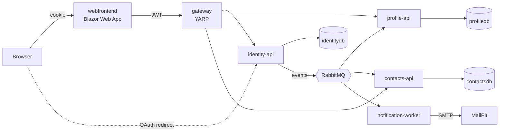

# Aspire Starter App

A .NET Aspire microservices starter with **simple login, OAuth login (Google / Microsoft / GitHub), register, logout,
email confirmation, forgot / reset / change password, delete account, user profile and a sample Contacts module**.

## Architecture



| Project | Responsibility |
|---|---|
| `AspireStarter.AppHost` | Aspire orchestrator: Postgres (+pgAdmin), RabbitMQ, MailPit and every service |
| `AspireStarter.ServiceDefaults` | OpenTelemetry, health checks, service discovery, resilience |
| `AspireStarter.Contracts` | DTOs and integration events shared by services and the web app (no dependencies) |
| `AspireStarter.Shared` | JWT validation, RabbitMQ event bus, request validation, DB initialiser |
| `AspireStarter.Identity.Api` | ASP.NET Core Identity, JWT and rotating refresh tokens, OAuth, roles |
| `AspireStarter.Profile.Api` | User profile. Created automatically from the `UserRegistered` event |
| `AspireStarter.Contacts.Api` | Sample business module: CRUD, search, paging and favorites for each user |
| `AspireStarter.Notification.Worker` | Sends welcome, confirmation, reset, password-changed and account-deleted emails |
| `AspireStarter.Gateway` | YARP reverse proxy. Routes `/api/identity`, `/api/profile` and `/api/contacts` |
| `AspireStarter.Web` | Blazor Web App (static SSR). Cookie session that holds the JWT and refreshes it silently |

**How auth works:** the web app posts credentials to Identity (through the gateway) and gets back an access token
(15 minutes) and a refresh token (7 days). It stores both inside an encrypted, HTTP-only auth cookie. Every API call
sends `Authorization: Bearer …`. Each API validates the JWT itself with the shared signing key. Before the access
token expires, the cookie's `OnValidatePrincipal` rotates the refresh token. If an old refresh token is used again,
Identity revokes every session for that user.

**OAuth:** the browser is redirected to Identity, which runs the provider challenge. Identity then sends the browser
back to the web app with a one-time code (valid for 2 minutes), and the web server exchanges that code for tokens
server-to-server. Tokens never appear in the browser URL.

## Prerequisites

- .NET 10 SDK
- Docker Desktop or Podman, running
- Visual Studio 2022 17.14+ / VS 2026, Rider, or VS Code with C# Dev Kit
- A trusted HTTPS dev certificate: `dotnet dev-certs https --trust`

## Run it

```bash
dotnet run --project src/AspireStarter.AppHost
# or, with the Aspire CLI:  aspire run
```

The Aspire dashboard opens automatically. From it you can open:

| Resource | URL (dev) |
|---|---|
| Web app | https://localhost:7000 |
| Gateway | https://localhost:7100 |
| Identity API | https://localhost:7101 (OpenAPI at `/openapi/v1.json`) |
| MailPit inbox | the `mailpit` → `http` endpoint link in the dashboard |
| pgAdmin / RabbitMQ management | the links in the dashboard |

Register an account, then open the MailPit inbox to see the welcome and confirmation emails.

## Configuration

| Setting | Where | Default |
|---|---|---|
| JWT signing key | AppHost `Parameters:jwt-signing-key` (`appsettings.Development.json`) | dev value. **Change it** |
| Require confirmed email to log in | Identity `Identity:RequireConfirmedEmail` | `false` |
| Token lifetimes | Identity `Jwt:AccessTokenMinutes` / `Jwt:RefreshTokenDays` | 15 / 7 |
| Seed an admin account | Identity `SeedAdmin:Email` / `SeedAdmin:Password` | empty (no admin is created) |

To move the JWT key out of source control:

```bash
cd src/AspireStarter.AppHost
dotnet user-secrets set "Parameters:jwt-signing-key" "<a random string of 64+ characters>"
```

### Enabling OAuth providers

A provider button appears on the login page only after that provider's credentials are set. Store them as Identity
user-secrets:

```bash
cd src/AspireStarter.Identity.Api
dotnet user-secrets set "Authentication:Google:ClientId" "..."
dotnet user-secrets set "Authentication:Google:ClientSecret" "..."
dotnet user-secrets set "Authentication:Microsoft:ClientId" "..."
dotnet user-secrets set "Authentication:Microsoft:ClientSecret" "..."
dotnet user-secrets set "Authentication:GitHub:ClientId" "..."
dotnet user-secrets set "Authentication:GitHub:ClientSecret" "..."
```

Redirect URIs to register with each provider (these point at Identity, not at the web app):

- Google: `https://localhost:7101/signin-google`
- Microsoft: `https://localhost:7101/signin-microsoft`
- GitHub: `https://localhost:7101/signin-github`

## API surface (through the gateway)

**Identity** `/api/identity`: `register`, `login`, `refresh`, `logout`, `me`, `confirm-email`, `resend-confirmation`,
`forgot-password`, `reset-password`, `change-password`, `delete-account`, `external/providers`, `external/{provider}`,
`external/callback`, `external/exchange`, and `admin/users` (Admin role only).

**Profile** `/api/profile`: `GET /me`, `PUT /me`.

**Contacts** `/api/contacts`: `GET ?search=&favorites=&page=&pageSize=`, `GET /{id}`, `POST`, `PUT /{id}`,
`POST /{id}/favorite`, `DELETE /{id}`.

**Events** (RabbitMQ topic exchange `aspirestarter.events`): `UserRegistered`, `EmailConfirmationRequested`,
`PasswordResetRequested`, `PasswordChanged`, `UserDeleted`.

## Adding a new module (microservice)

1. Copy `AspireStarter.Contacts.Api` to `AspireStarter.<Module>.Api`, then rename the namespaces and the DbContext.
2. Add its DTOs and events to `AspireStarter.Contracts/<Module>/`.
3. Add it to `AspireStarter.slnx`.
4. In `AppHost.cs`:
   ```csharp
   var ordersDb = postgres.AddDatabase("ordersdb");
   var ordersApi = builder.AddProject<Projects.AspireStarter_Orders_Api>("orders-api")
       .WithReference(ordersDb).WaitFor(ordersDb)
       .WithReference(messaging).WaitFor(messaging)
       .WithEnvironment("Jwt__SigningKey", jwtSigningKey);
   // then add .WithReference(ordersApi) to the gateway
   ```
5. In the Gateway's `appsettings.json`, add a route `/api/orders/{**catch-all}` and a cluster `https+http://orders-api`.
6. If the module stores per-user data, subscribe to `UserDeleted`:
   `builder.Services.AddIntegrationEventHandler<UserDeleted, UserDeletedHandler>("orders.user-deleted");`
7. Add a typed client in `AspireStarter.Web/Services` and pages under `Components/Pages/<Module>`.

## Before going to production

- Replace `EnsureCreated` with EF Core migrations (`dotnet ef migrations add Initial`, then `Database.MigrateAsync()`).
- Use an outbox (for example MassTransit or Wolverine) so events are never lost, and add a dead-letter queue.
- Replace the shared HMAC key with RS256 plus a JWKS endpoint, or move to Keycloak / Entra ID / Duende.
  Keep secrets in Key Vault.
- Add rate limiting to login, register and forgot-password at the gateway.
- Swap MailPit for a real email provider (SendGrid, Azure Communication Services, SES).
- Persist Data Protection keys (Redis or blob storage) when you run more than one replica of Web or Identity.
- Account linking by email assumes the provider has verified the email. Keep that in mind for GitHub.
